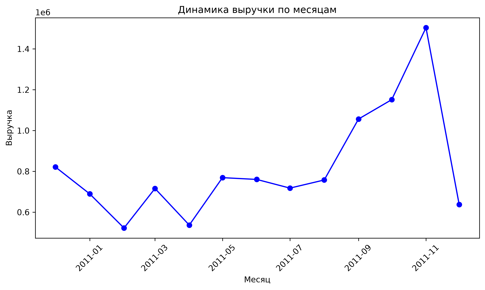
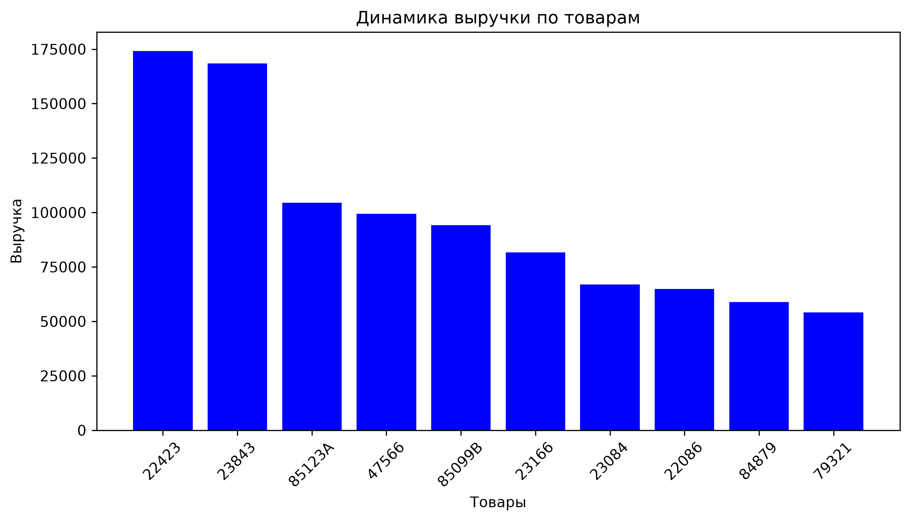

# Retail Sales Analytics

### Анализ розничных продаж на Python и SQL

Цель проекта — исследовать транзакционные данные интернет-магазина, изучить качество исходных данных, рассчитать выручку и определить особенности продаж по месяцам, странам и товарам.

**Задачи:**
* Изучить структуру и основные характеристики датасета.
* Проверить пропуски, полные дубликаты и нестандартные значения.
* Определить правила обработки дубликатов, отмен и операций с необычными ценами.
* Рассчитать выручку по операциям, отнесённым к обычным продажам.
* Исследовать помесячную динамику и распределение выручки по странам.
* Определить товары с наибольшей выручкой и количеством продаж.
* Сопоставить результаты Python-анализа с расчётами в PostgreSQL.

## 1. Данные и инструменты

В работе использован набор данных **Online Retail** из UCI Machine Learning Repository. Он содержит сведения о транзакциях интернет-магазина за период с 1 декабря 2010 года по 9 декабря 2011 года.

Исходный датасет включает **541 909 строк** и **8 столбцов**.
**Источник данных:** [UCI Machine Learning Repository](https://archive.ics.uci.edu/dataset/352/online+retail)

**Инструменты проекта:** Python, Pandas, JupyterLab, PostgreSQL, DBeaver, Matplotlib, SQLAlchemy, GitHub.

## 2. Первичный анализ и качество данных

На первом этапе были изучены типы данных, временной диапазон, количество уникальных стран и товарных кодов, а также пропущенные значения и подозрительные записи.

* **Строки в исходном датасете:** 541 909
* **Столбцы:** 8
* **Пропуски в Description:** 1 454
* **Пропуски в CustomerID:** 135 080 (около 24,93%)
* **Полные дубликаты:** 5 268
* **Отрицательное Quantity:** 10 624
* **Отрицательный UnitPrice:** 2
* **Счета, начинающиеся с C:** 9 288
* **Страны:** 38
* **Уникальные StockCode:** 4 070

В 1 336 строках с отрицательным количеством и нулевой ценой отсутствовал `CustomerID`. В 862 из этих строк также отсутствовало описание товара. Эти записи не позволяют надёжно установить клиента, поэтому их следует рассматривать отдельно от обычных продаж.

## 3. Подготовка данных и правила расчёта

Полные дубликаты удалены с помощью `drop_duplicates()`, при этом остальные строки с пропусками сохранены.

**Принятые правила:**
* **Полные дубликаты:** удалить.
* **Пропуски Description:** сохранить строки.
* **Пропуски CustomerID:** сохранить строки.
* **Отрицательное Quantity:** не смешивать с обычными продажами.
* **Отрицательный UnitPrice:** исключить из выборки обычных продаж.
* **Фильтр обычных продаж:** `InvoiceNo` не начинается с C; `Quantity > 0`; `UnitPrice > 0`.

После удаления дубликатов размер очищенного набора составил **536 641 строку**. Был рассчитан показатель `Revenue = Quantity × UnitPrice`.

Выборка обычных продаж содержала **524 878 строк**. Общая выручка составила **10 642 110,804** в единицах валюты исходного набора.

## 4. Анализ выручки по месяцам

Была рассчитана сумма `Revenue` для каждой календарной группы.

**Топ-5 месяцев по выручке:**
1. 2011-11: 1 503 866.780
2. 2011-10: 1 151 263.730
3. 2011-09: 1 056 435.192
4. 2010-12: 821 452.730
5. 2011-05: 769 296.610

Наибольшая выручка наблюдалась в **ноябре 2011 года**. Данные показывают усиление продаж в сентябре–ноябре и снижение в декабре. Важно учитывать, что данные заканчиваются 9 декабря, поэтому этот месяц представлен не полностью.

## 5. Анализ выручки по странам и клиентам

Выручка была сгруппирована по странам.

**Топ-5 стран по выручке:**
1. Великобритания: 9 001 744.094
2. Нидерланды: 285 446.340
3. Ирландия (EIRE): 283 140.520
4. Германия: 228 678.400
5. Франция: 209 625.370

В десятке лидеров заметно доминирует Великобритания. Топ-10 клиентов формируют лишь около **14%** от общего оборота, что свидетельствует о широкой клиентской базе и отсутствии критической зависимости от нескольких оптовиков.

## 6. Анализ товарных позиций

Первоначальный рейтинг включал служебные позиции (`DOT`, `POST`, `M`). Для содержательного рейтинга эти коды были исключены. Для товара 85123A применено правило группировки строго по коду, поэтому сумма учитывает все варианты написания описания.

**Топ-5 товаров по выручке:**
1. 22423 (REGENCY CAKESTAND 3 TIER): 174 156.54
2. 23843 (PAPER CRAFT, LITTLE BIRDIE): 168 469.60
3. 85123A (WHITE HANGING HEART T-LIGHT HOLDER): 104 462.75
4. 47566 (PARTY BUNTING): 99 445.23
5. 85099B (JUMBO BAG RED RETROSPOT): 94 159.81

По **количеству** проданных единиц лидируют: 23843 (80 995 шт.) и 23166 (78 033 шт.). Рейтинг по количеству отличается от рейтинга по выручке, так как товары различаются по цене.

## 7. Отмены, возвраты и нестандартные операции

Отрицательные количества нельзя автоматически считать обычными продажами. Их выделили отдельно:
* **Счета, начинающиеся с C:** 9 251 строка (сумма Revenue: -893 979,73).
* **Отрицательное Quantity без C:** 1 336 строк (сумма Revenue: 0,00).
* **Отрицательный UnitPrice:** 2 строки (сумма Revenue: -22 124,12, Adjust bad debt).

По одним лишь доступным полям нельзя окончательно установить экономический смысл каждой необычной операции, поэтому их лучше не смешивать с обычными продажами.

## 8. Проверка результатов с помощью SQL

Данные были проанализированы в PostgreSQL. Сверка результатов показала полное совпадение: общая выручка в Python составила 10 642 110,804, и точно такая же сумма была получена при выполнении SQL-запроса. Это служит проверкой корректности группировок.

## 9. Ограничения анализа

* В данных отсутствует примерно четверть `CustomerID`, поэтому анализ поведения конкретных клиентов ограничен.
* Данные охватывают период по 9 декабря 2011 года, декабрь неполный.
* Назначение всех отрицательных количеств не подтверждено.
* Для товарного рейтинга исключены служебные коды `DOT`, `POST` и `M`.
* Валюта не обозначена в используемых столбцах.

## 10. Заключение

В ходе проекта была проведена проверка данных Online Retail, выявлены пропуски, дубликаты и нестандартные операции, подготовлена очищенная таблица и сформирована выборка обычных продаж. Рассчитанная выручка составила **10 642 110,804**.

Анализ показал, что максимальная выручка пришлась на ноябрь 2011 года, а Великобритания занимает первое место среди стран. Результаты были дополнительно проверены с помощью PostgreSQL.

**Практические рекомендации:** бизнесу стоит сфокусировать усилия на подготовке к осенне-зимнему сезону. Также рекомендуется развивать клиентскую базу в Великобритании, параллельно исследуя потенциал роста в Нидерландах и Ирландии.

В результате проект демонстрирует полный базовый аналитический процесс: изучение данных, обоснование правил обработки, расчёт показателей, визуализацию и сверку результатов между Python и SQL.
